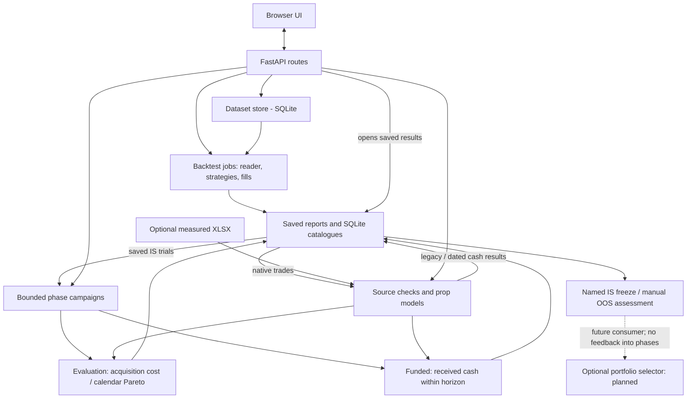

# Architecture

7 November 2026 additive research increment: `research_folds.py` owns immutable
CME-session windows; `edge_qualification.py` assesses bounded inner evidence and
returns the full qualifying set; `robust_research.py` orchestrates ordinary
`run_backtest` execution and references results in the existing campaign and
AnalysisStore catalogue. `robust_research_api.py` extends the campaign API;
`web/research_workflow.js` extends saved-report prop configuration and normal
analysis reports. There is no additional service, database or backtest engine.
Inner research checkpoints retain run IDs and file hashes for safe resumption.
`execution_scenarios.py` resolves declared costs/fill assumptions for the existing
execution engine; saved baseline/resolved settings prevent replay double charges.
`research_regimes.py` fits training-only thresholds and classifies entries from
strictly prior bars. `research_complexity.py` supplies reviewed parameter roles;
the qualifier excludes sizing/display axes from signal neighborhoods. All three
feed the same saved research report, with no alternative calculation service.
Outer economic validation and forward monitoring are still pending; see the
[requirements traceability and milestone checklist](robust_research_plan.md).

8 November 2026 extension: `research_phase_selection.py` validates complete PASS
membership, phase declarations and immutable frozen packages. It delegates
simulations and feasibility/ranking to the existing phase owners. Server-only
training context in `prop/phase_search.py` verifies full-window training reports,
source/artifact hashes and observed session inventories without relabeling inner
runs as public IS. AnalysisStore reserves and executes nested child calculations
inline on the existing worker, avoiding a same-worker submit/wait deadlock.
Typed checkpoints and ordered selection/access seals use the existing
`robust_research_steps` table. Evaluation/Funded chronological replay remains in
their respective `*_profiles.py` owners, sharing calendar and receipt helpers in
`cash_ledger.py`. `rule_provenance.py` captures dated primary-document reviews and
unverified model gaps in normal phase reports; it never patches account rules.
No new engine, service, database or production evidence store is introduced.
The subsequent reliability extension adds predeclared reference contexts and a
reference seal before any outer access. References use the same source checks,
phase reports and replay owners; failed edge qualification remains visible and
cannot become recommendation authority. `research_reliability.py` consolidates
saved outputs without simulating accounts or choosing a new winner. It preserves
fold denominators, family alternatives and censored observations, and separates
actual economics from forecast comparability. Conservative Funded selection
re-estimates the fitted mean using historical session blocks inside
`funded_profiles.py`; `funded_optimization.py` owns its objective and constraints.
Shared preflight limits count all declared historical refits and captured indices.
Final procedure verification, native forecasting/selection and forward monitoring
remain pending. Native chronological reruns are described below.

8 November 2026 canonical-source increment: `canonical_trades.py` validates
complete versioned external exports and projects existing native sources without
inventing missing stop/decision data. `trade_imports.py` publishes immutable
original/canonical/trade/equity artifacts through RunStore. Reads verify hashes
without parsing or recalculating; new calculations also revalidate canonical
semantics. `prop/external_source.py` admits the documented ordered-mark subset,
normalizes actual costs exactly once, and captures source artifacts through the
existing AnalysisStore. Existing backtest/import/report and prop controls expose
this route. No second dataset, simulation engine or result store is introduced.
Independent phases now accept eligible external IS sources with explicit sizing
policies. Standalone external dated/budgeted replay remains pending.

`prop/sizing.py` owns pure causal quantity decisions; `sizing_runtime.py` maps
saved source facts and current account state into that contract. The existing
`native_engine.py` and `lucid_engine.py` call it before each opportunity, retain
their provider transitions, and omit all policy work on the legacy default path.
`phase_profiles.py` owns admission/configuration and bounded decision capture;
phase-specific profile/optimization modules keep their independent objectives.
The existing campaign declaration expands all source × cap × policy combinations.
Native `decision_capture.py` owns the optional normal-report sidecar. Execution
records decisions/fills separately; historical missing information stays missing.
Fixed-path phase searches still reject dynamic native policies.

`prop/native_replay.py` now orchestrates a checked historical MNQ/VWAP rerun
through the existing backtest engine. `execution.py` owns actual fills and
strategy/provider stop arbitration; the strategy admits provisional entries
before committing quantity-dependent state. `native_control.py` defines immutable
execution/account facts and a provider-to-trading-cash bridge. Evaluation and
Funded controllers live in their respective profile owners and call shared
provider transition primitives. `native_money.py` preserves exact native money
while keeping legacy float arithmetic unchanged. No new simulator or catalogue
is introduced: ordinary RunStore/AnalysisStore own the child, report and exports.
Native Monte Carlo, economic selection and campaign outer integration remain
pending. Numerical identities include all changed calculation dependencies;
historical reports are retained and incompatible frozen launches fail closed.

[Home](../README.md) / [Docs](README.md)

[Requirements](#requirements-and-scope) · [Workflow](#end-to-end-workflow) ·
[Code](#code-architecture) · [Decisions](#decisions)

Current-state cleanup reviewed 6 November 2026 against repository baseline
`445c14030c0e060d5844cfaa3bcf6564dd13a981` plus the local cleanup diff.
The [qualification record](prop_simulation_review.md#final-architecture-cleanup--2026-11-06)
records the actual gates, preserved identities and remaining limits.

Earlier code review, 31 October 2026: [6d290c5](https://github.com/yuxuantan/alphaquest-research-engine-2/tree/6d290c5e429c745a4af600e4da7218c680f9a77a).

Phase-optimization architecture review, 5 November 2026:
`71f97a61e568b39b6bf17647078dcdb2364069cb`. The status below supplements the
earlier review; it does not claim a new numerical or provider qualification.

## Requirements and scope

AlphaQuest is a local, single-user futures research app. It must:

- Validate CSV data and preserve its bytes, timezone and identity.
- Run strategies and parameter searches through the same execution engine, with explicit fills, costs and instrument settings.
- Separate in-sample (IS) research from manually launched out-of-sample (OOS) tests; save each run's settings.
- Calculate supported Apex/LucidFlex prop outcomes locally; check source trades/costs and disclose missing or bar-based risk data.
- Save reports and downloads so reopening never reruns or changes them. External prop outcomes are comparison references only; validated external trade/fill/risk observations may supply local calculations.

The business goal is to maximize expected cash received minus added costs within
a set period and loss/spending limits. Current default sizing uses annual slot
economics. The implemented budgeted method replays dated cash for one initially
unfunded slot on observed history; it is not a sampled forecast or optimizer.
The standalone Evaluation backend minimizes acquisition cost/calendar time using
a Pareto frontier. Independent funded-stage horizon cash optimization conditional
on already being funded is also implemented through the same phase-report workflow. A portfolio optimizer is optional
downstream work. The proof of concept lasts six months; set the trading
period separately. Order-book depth (L2), a tested MultiCharts .NET live route,
and multi-strategy allocation remain proposed. Standalone canonical external
trade imports are now supported within the documented source-admission limits.
The long-term depth goal covers historical research and live execution; define
fields, depth, event timing, coverage and replay needs per strategy. Full
MultiCharts feature parity and commercialization are outside the initial scope.
Judge the POC by mechanics, repeatability, prop accuracy, execution reliability,
research throughput, spending and engineering hours.

### Implemented versus planned

| Capability | Status at this review |
| --- | --- |
| Saved IS backtests, single-strategy parameter grids, manual OOS and local prop reports | Implemented. Each trial uses the existing engine; OOS remains manual and unlimited with recorded history. |
| Canonical external trades | Implemented 8 November 2026: complete versioned exports, exact cost/identity/event validation, ordinary saved reports/catalogue/downloads, eligible annualized local prop analysis and independent IS phase policies. Generic platform CSV, partial-position paths and native external reruns remain unsupported. |
| State-aware phase sizing | Fixed contracts, fixed dollars and explicitly based percentage risk run inside existing account transitions for admitted invariant external paths. Whole-MNQ rounding, skips, user/provider/cushion caps and decisions are saved. Native risk-based resizing requires a strategy rerun; no invariant-path claim is made from stop capture alone. |
| Annualized joint evaluation/funded sizing | Implemented and still the default. Classified as **legacy business-level optimization**, not the target independent phase selector. Preserve calculations, regression tests and historical reports until separately approved retirement. |
| Separate evaluation/funded sources and fixed targets | Implemented in dated lifecycle and budgeted replay. This is separate phase configuration, not independent optimization. Standalone dated mode remains API/report compatible but is no longer a new portal choice. |
| Exact cash ledger and hard monthly acquisition cap | Portfolio milestones 1–2 complete per the existing progress/evidence logs. One observed path and one initially unfunded slot; modeled settlement assumptions remain explicit. |
| Independent simulation profile components | Implemented as Python APIs in `evaluation_profiles.py` and `funded_profiles.py`, with frozen contracts in `phase_profiles.py`. Single saved source per phase; existing kernels/cost/risk checks. Weekday and modeled payout-time semantics; no new portal mode or independent selector. |
| Standalone Evaluation optimizer | Implemented backend/API, 6 November 2026: explicit comparable saved IS candidates, local Apex EOD empirical IID retries, declared calendars, censoring and complete estimated Pareto frontier. No funded selection inputs or implicit winner. Campaign UI is now available; Lucid dated attempts and robust simultaneous dominance remain deferred. [Exact formulas and assumptions](prop_simulation.md#standalone-evaluation-optimizer--2026-11-06). |
| Independent Funded optimizer | Implemented backend/API, 6 November 2026: saved IS candidate ranking by received cash over a declared calendar horizon, fresh funded accounts, native Apex/Lucid transitions, explicit settlement lag, hard empirical constraints and censored lifetime. No evaluation inputs or joint score. Campaign UI and IS freeze are implemented by the subsequent campaign increment. [Contract](prop_simulation.md#standalone-funded-optimizer--2026-11-06). |
| Cross-job/strategy campaigns and phase package freeze | Implemented, 6 November 2026: saved grid/trial expansion, size budgets, IS compatibility, independent phase execution, immutable source/report references, browser controls and freeze. [Campaign API](research_campaign_api.md). |
| Frozen OOS phase assessment | Implemented: manual ordinary OOS backtests from frozen IS parents, fixed phase settings, append-only assessment reports in AnalysisStore; no OOS ranking/reselection. |
| Automatic new campaign grids and adaptive refinement | Planned. Campaigns consume already saved trials. |
| Synchronized portfolio allocation/shared-account optimization | Optional, outside the initial phase implementation; later consumer of phase outputs and dependence data. See [portfolio plan](prop_portfolio_plan.md). |

## End-to-end workflow

Start with the [setup instructions](../README.md#run), then use the existing portal:

1. **Datasets:** validate/save a CSV with its source timezone, tick size and point value.
2. **Strategies → New backtest:** choose strategy, costs and IS/OOS split. Equal parameter bounds run one combination; wider ranges run a grid through the same engine. Initial runs use IS only.
3. **Open the saved report:** inspect trades, metrics and the holding comparison. New runs attempt default legacy Apex/LucidFlex prop analyses unless the grid opts out; incompatible sources show a reason. The choice is saved per new grid and does not alter existing jobs.
4. **Configure prop analysis → Check source → Run analysis:** inspect native risk data or a matching optional MultiCharts export. Choose existing annualized sizing, or budgeted cash replay with separate fixed phase sources/sizes, observed dates, monthly cap and explicit timing assumptions. Save/reopen the normal report and downloads. Annualized internal training/holdout stays within the chosen research period; budgeted replay uses the declared common observed window.
5. **Run OOS with these parameters:** manually launch from a completed IS report using its saved window/settings. Splits remain editable and attempts unlimited; record prior data access before treating OOS as untouched final evidence.

Before a final research decision, set limits and freeze the selected package
([research checks](research_workflow.md#campaign-checks)). A later live pilot also
needs real permissions, routing, protection and recovery tests; this workflow
does not place live orders. See [product steps](strategies_navigation.md) and
[prop model details](prop_simulation.md).

For independent research in step 4, create an Evaluation or Funded campaign,
select saved IS sources/jobs and explicit sizes within a budget, check and run,
inspect the full frontier/ranking, then freeze named choices. **Launch OOS with
frozen settings** creates ordinary OOS backtests and an assessment-only phase
report; it cannot rank OOS or change the IS package. The
[campaign guide](research_campaign_api.md) describes the available controls.

## Code architecture

One local server serves the UI and APIs. Arrows show calls/data flow, not separate
services. Jobs use local threads/processes; reports and catalogues share one data root.

| Component | Code | Why separate |
| --- | --- | --- |
| UI and HTTP | [Portal](../alphaquest/web/index.html), [UI code](../alphaquest/web/app.js), [app](../alphaquest/app.py), [backtest API](../alphaquest/backtest_api.py), [prop API](../alphaquest/prop_api.py) | Forms/routes collect settings and coordinate work; calculations stay reusable. |
| Data | [datasets](../alphaquest/datasets.py), [reader](../alphaquest/backtest_data.py) | Validate and snapshot saved bytes; stream bars without changing source data. |
| Strategies and fills | [registry](../alphaquest/strategies/registry.py), [interface](../alphaquest/strategy.py), [execution](../alphaquest/execution.py) | Strategies request orders; the shared engine applies fills/costs. New strategies reuse execution rules. |
| Research and jobs | [splits/OOS](../alphaquest/research.py), [grids](../alphaquest/optimization.py), [workers](../alphaquest/optimization_worker.py) | Trials share the backtest path; workers calculate, the coordinator publishes. |
| Prop calculations | [source checks](../alphaquest/prop/source.py), [analysis](../alphaquest/prop/native_analysis.py), [Apex](../alphaquest/prop/native_engine.py), [Lucid](../alphaquest/prop/lucid_engine.py), [costs](../alphaquest/prop/commissions.py) | Adapt/check trades before account simulation. Firm rules and sizing remain separate from strategy backtests. |
| Independent phase profiles | [contracts/source admission](../alphaquest/prop/phase_profiles.py), [evaluation profiles](../alphaquest/prop/evaluation_profiles.py), [funded profiles](../alphaquest/prop/funded_profiles.py) | Expose single-source evaluation/acquisition and conditional-funded simulations independently. Evaluation has no funded input; Funded has no evaluation fees/pass-rate input or replacement. Reuse existing provider backends; no service, database or result store. |
| Standalone Evaluation search | [Evaluation optimizer](../alphaquest/prop/evaluation_optimization.py), [normal API](../alphaquest/prop_api.py), [AnalysisStore](../alphaquest/prop/store.py) | Check every saved IS candidate; compose component outcome/duration laws into dated independent retries; retain the full strict cost/time Pareto set, ties and unresolved candidates. Capture format-4 phase artifacts through the existing worker/catalogue and download paths. Campaign UI uses this backend; the annualized selector is unchanged. |
| Standalone Funded search | [Funded optimizer](../alphaquest/prop/funded_optimization.py), [dated funded component](../alphaquest/prop/funded_profiles.py), [shared admission/calendar](../alphaquest/prop/phase_search.py), normal API/AnalysisStore | Fresh funded paths, native qualification and termination, exclusive calendar cutoff and explicit modeled receipts; full feasible ranking, uncertainty and path events in format-5 reports. Shares source capture and worker/catalogue with Evaluation; campaign UI is implemented, with no new service, database or portfolio calculation. |
| Legacy business sizing | [joint sizing](../alphaquest/prop/joint_sizing.py), [account refresh links](../alphaquest/optimization_prop.py) | Joint annualized cost/payout selection and immutable refresh history remain supported; new independent optimizers must not use their score as a phase objective. |
| Dated phase and cash replay | [phase lifecycle](../alphaquest/prop/phase_lifecycle.py), [cash ledger](../alphaquest/prop/cash_ledger.py) | Share local account transitions; distinguish paid acquisition fees, requests, deductions and modeled receipts under a hard monthly cap. |
| Default prop reports | [automatic](../alphaquest/prop/automatic.py), [backend](../alphaquest/prop/native_backend.py), [build](../setup.py) | Automatic/manual runs share local models. Optional compiled kernels use the same model source. |
| Reports and storage | [reporting](../alphaquest/reporting.py), [benchmark](../alphaquest/market_benchmark.py), [backtest store](../alphaquest/backtest_runs.py), [analysis store](../alphaquest/prop/store.py) | Stage calculations, publish completed results, reopen without replay. SQLite indexes files and job state. |
| Reuse | [replay cache](../alphaquest/replay_cache.py), [features](../alphaquest/strategy_features.py), [calculation cache](../alphaquest/prop/calculation_cache.py) | Reuse matching data/calculations by identity; never share mutable strategy positions between trials. |

A local server, SQLite and files keep setup small. Separate services or a database
server would add operations; reconsider for remote/multi-user use. See
[storage and import contracts](architecture_reference.md) for formats and limits,
[execution assumptions](backtest_contract.md) for strategy-specific behavior, and
[tests/review records](prop_simulation_review.md) for dated evidence. Code links
show implementation, not a new test pass or proof of MultiCharts trade parity.

The profile components are callable from Python and retain the current kernels'
weekday sampling and payout-time modeled receipt convention. The additive dated funded runner composes those same account transitions; the
legacy weekday component contract remains unchanged. `native_analysis.training_economics` and
`_funded_profile` are compatibility wrappers over the extracted acquisition and
lifetime routines. Joint selection, historical report shapes and calculations
remain supported; complete deterministic Apex/Lucid payloads match the captured
pre-refactor baseline. See [component contracts and limits](phase_optimization_plan.md#implemented-precursor-independent-simulation-profiles)
and [review evidence](prop_simulation_review.md#independent-phase-component-extraction--2026-11-05).

Evaluation contracts/retries/Pareto live in `prop/evaluation_optimization.py`;
Funded contracts/receipt ranking live in `prop/funded_optimization.py`.
`prop/phase_search.py` shares source admission, calendars and capture.
`prop/phase_dispatch.py` resolves only the requested independent backend for
HTTP, campaigns and AnalysisStore; unknown phases reject instead of falling
through to another phase. `research_campaigns.py` owns saved-trial expansion,
freeze and assessment provenance. The proposed `phase_optimization.py` and
`phase_sampling.py` were not created; do not add parallel orchestration simply
to match earlier proposed filenames. All work uses existing routes, workers,
backtest catalogue and AnalysisStore. See the
[responsibility and contract map](phase_optimization_plan.md#target-architecture-and-module-responsibilities).

## Final module ownership and retention

| Classification | Modules | Active dependencies and retention decision |
| --- | --- | --- |
| Primary phase simulation | `prop/evaluation_profiles.py`, `prop/funded_profiles.py` | Independent single-source and dated-funded runners; also own legacy acquisition/lifetime helpers called through `native_analysis` compatibility delegates. Keep these delegates and seed/dictionary semantics. |
| Primary phase selection | `prop/evaluation_optimization.py`, `prop/funded_optimization.py` | Own phase contracts, metrics, frontier/ranking and format-4/5 artifact schemas. Opposite-phase inputs reject. No call to the legacy joint selector. |
| Shared phase infrastructure | `prop/phase_profiles.py`, `prop/phase_search.py` | Frozen types, profile/source/risk/cost admission, source/model identity, calendar and unique source capture. Already shared: no second validation/sampling engine added. |
| Refactored dispatch | `prop/phase_dispatch.py`, `prop_api.py`, `prop/store.py`, `research_campaigns.py` | Central lazy backend resolution removes repeated phase imports/route branches. Store owns queue/source locks, resource preflight, atomic sealing and persistence; campaigns reference those outputs. Existing `submit_evaluation`/`submit_funded` remain compatibility methods. |
| Legacy joint business optimizer | `prop/joint_sizing.py`, annualized `prop/native_analysis.py` | Still active via automatic/manual annualized reports, account refresh, joint regression tests and prior report meanings. Joint search is deliberately coupled at the business level; new phase selection cannot call it. No retirement in this task. |
| Retained kernels and observed cash | `prop/native_engine.py`, `native_backend.py`, `lucid_engine.py`, `lucid_backend.py`, `lucid_rules.py`, `phase_lifecycle.py`, `cash_ledger.py` | Account transitions, compiled/reference equivalence, dated one-path replay and exact monthly fee cap. No kernel or numeric formula rewritten. |
| Refactored research job option | `backtest_requests.py`, `optimization.py`, `optimization_worker.py`, shared grid UI | New `automatic_prop: false` skips automatic joint simulations and the calculation-cache snapshot. Default true; job profile, metric columns and trial reuse key distinguish modes. Ordinary source reports remain campaign inputs. Worker already supports `default_prop=False` and is retained. |
| Historical notebook entry point | `prop/analysis.py` | Imported by `scripts/demo_prop_analysis.py`, `tests/test_prop_notebook.py`, `tests/test_prop_adapter.py`; retains notebook preparation/execution/cleaning and pinned evidence. No active production portal caller. |
| Historical notebook numerical model | `prop/model.py` | `analysis.py` and notebook parity tests use `NotebookModel`; retain the extraction and all numerical cells unchanged. Header mentions the former extractor; no current `scripts/extract_prop_model.py` exists. Do not regenerate from an assumed tool. |
| Historical notebook settings | `prop/settings.py` | `analysis.py` and notebook tests use pinned defaults/version/checksum/presets. Production settings live in `native_analysis.py`; these defaults are not an independent optimizer configuration. |
| Historical readers | `web/prop.js`, `prop/store.py` | Format-1 notebook and format-2 external reports remain readable with historical notices; format-3 annualized/dated/cash and format-4/5 phase reports remain distinct. Reading never imports or reruns NotebookModel or an external engine. |
| Retired production modules | None | No audited module is proven unnecessary across runtime, tests, demos and historical compatibility. Proposed filenames are not implemented modules to delete. No obsolete UI or notebook evidence removed. |

Common artifact publication already lives in AnalysisStore (`seal_report`, file
allowlist, checksums, ZIP), and `phase_search.capture_inputs` deduplicates source
files within phase reports. The phase-specific writers retain different sampling,
uncertainty and frontier/ranking schemas. Combining them would change hashed
calculation modules without removing a second storage path. This cleanup leaves
all phase implementation/rule/kernel identities byte-for-byte unchanged. Backtest
trial identity conservatively hashes all production Python, so new code safely
invalidates backtest reuse/resume against an older engine; old reports still open.
Frozen phase package model identities remain valid when their sources/strategies
are otherwise compatible. No calculation hash is bypassed or relabelled.

Performance remains bounded by 10,000 backtest combinations, configured worker
limits, 128 phase candidates, 20,000 paths per candidate and report-size preflight.
Funded adds a 50-million path-calendar-day cap. Large grids should opt out of
automatic joint reports and run only the declared independent campaigns. Source
revalidation at check/run/publication is deliberate protection against mutation.
Evaluation retains both legacy retained-block diagnostics and IID dated chains;
these are distinct estimands, not interchangeable cached results. Repeat campaigns
reuse the same verified phase report; reads/downloads never backtest or simulate.
Adaptive screening and broader profile/uncertainty work remain future research.

## Decisions

These choices are **proposed**; adoption dates are unset.
Test platforms and feeds on the actual setup.

| Area | Choice and reason | Alternatives / why deferred | Reconsider when |
| --- | --- | --- | --- |
| ADR-00 · Design | Established execution software plus Python research; focus custom work on prop economics. | Fully custom: more maintenance and delayed research. Platform-only: lacks the required analysis. | First campaign shows excessive cost, effort or interface problems. |
| ADR-01 · Research | ChatGPT Work for discovery, comparison and hypotheses; verify original sources to save reading time safely. | Manual review is slower. AI can misattribute or wrongly transfer findings between markets; papers do not validate our implementation. | Errors recur, sources are inaccessible or checking costs more time than saved. |
| ADR-02 · Coding | Codex with a written specification; extend Python, add C# for the execution target when justified. | Manual coding takes longer. Two implementations add maintenance and can share the same specification error; compare each with independent cases. | Execution target changes or maintaining parity stops being worthwhile. |
| ADR-03 · Visual checks | Reuse paid MultiCharts .NET charts/imports/trade markers; familiar tools and no extra visual licence while covered. | TradingView for bars, Sierra depth replay/ACSIL or Python traces; switching adds validation work. Charts/DOM alone do not prove historical depth replay or queue-aware fills. | Required features cannot be checked, or another reference meets needs more easily. |
| ADR-04 · Tracking | AlphaQuest for runs, Git for code, run folders for large logs/evidence; optional Sheets links research, campaigns, variants and run IDs. | Manual status updates can drift; a custom tracker adds code and duplicate state. Status without evidence cannot approve deployment. | Review after 10 strategies, or sooner if manual updates cause repeated errors. |
| ADR-05 · History | Start with verified/licensed Sierra history and TIP bridge features; low spending limits which strategies are possible. Specify fields/period first. | Compare bought/recorded data on equal coverage/rights. Trades alone are not synchronized quotes/depth. Rithmic bulk history remains conditional on contract/range limits; live access is not a history purchase. | A strategy needs missing fields, depth or history; no need to exhaust L1 first. |
| ADR-06 · Prop models | AlphaQuest owns simulation, sizing, economics and saved reports; no extra engine licence, but testing/maintenance still cost effort. | Platform reports/notebooks lack the full workflow. External engines remain references only. Closed trades alone may not support intraday equity rules. | Reference cases differ or build spending stops improving decisions. |
| ADR-07 · Live data | Reuse prop-provided Rithmic through MultiCharts for entitled L1/L2; avoid a second feed subscription where the needed data is included. | Databento is the planned paid option for MBO/L3 or independent history/API needs. Platform access is not custom API permission; L2 inclusion depends on the plan. | Missing fields, outages, changed fees/permissions or inadequate quality; verify depth and session limits. |
| ADR-08 · Execution/hosting | Propose MultiCharts .NET; choose Parallels/VPS by uptime, supervision and recovery needs. Count shared platform costs once. | Sierra, NinjaTrader, MotiveWave or Python adapters add integration work; VPS adds cost. Enough CPU/RAM does not prove reliability. PickMyTrade is optional, not automatically another charge. | Routing/recovery fails, licences/connections are unsuitable or another option costs less overall. |
| ADR-09 · Reconciliation | Compare expected signals/orders, submissions, acknowledgements, fills and positions with broker records; quick setup, recurring manual review. | Automated imports/APIs/aggregation need integration/testing. Broker records establish actual fills/exposure; missing protection or unexplained positions differ from ordinary fill variation. | Review exceeds 30 minutes/day or detection is too slow. |
| ADR-10 · Repeatability | Save code, inputs, settings, rules, costs, data conventions and seeds; keep credentials outside versioned evidence. | Ad hoc files lose traceability; a versioning service adds setup. Check deterministic and random outputs using declared tolerances. | Data types, machines or volume outgrow simple manifests. |
| ADR-11 · Risk controls | Define where protective orders live, who controls them, account limits, stale-data actions, emergency intervention and restart. | Untested defaults lack proof; custom order management adds maintenance. Test the actual route and do not resume into unexplained broker state. | Incident, protective-order/routing/account change or platform limits require different controls. |
| ADR-12 · Selection | Set search limits; select on development prop economics, then freeze choices before final OOS. | P&L/win rate/profit factor omit account economics; Monte Carlo cannot replace OOS. | Holdout has been reused, rules/strategy change or evidence is too imprecise. |

Keep IDs and earlier reasons when changing decisions.

The data choice is about **incremental cost and exposed fields**, not a universal
“free L2 / paid L3” split. Lucid offers market depth, but its public pages do not
confirm free L2 for every Rithmic account. Databento is our planned MBO/L3 option;
Rithmic also advertises MBO, so Databento is not the only possible supplier.
See [checked access sources and assumptions](planning.md#market-data-access).

Cost reasons remain above; [dated planning figures](planning.md) are optional.
The [future export format](designs/trade_export_v1.md) is a proposal, not a supported input.

## Saved-trial campaign integration — 6 November 2026

`research_campaigns.py` owns immutable declarations, saved trial expansion,
compatibility/budget checks, status and freeze. `campaign_api.py` exposes those
operations under the existing FastAPI security middleware. `web/campaigns.js`
adds controls to the existing saved report → prop configuration → durable report
journey. There is no second web application or execution engine.

Five small additive tables in the existing AnalysisStore SQLite catalogue index
campaign declarations, source dependencies, optimization job dependencies,
calculation attempts and manual OOS assessment references/history. The backtest catalogue continues to own grids/trials;
AnalysisStore continues to own numerical outputs, captured inputs and downloads.
Identical campaign calculations reuse a sealed phase report. No source trades or
reports are copied into campaign storage. The shared reentrant analysis lock
serializes declaration/run/freeze with source/job/report deletion. Every referenced
source and report is protected, including when frozen; partial/failed attempts
cannot become a completed optimum and remain recorded after explicit retry.

Phase implementation and kernel hashes identify calculations independently of
UI/docs. Read/reopen never dispatches workers or reads dataset/OOS prices.
The complete API, exact one-stage screening/refinement semantics, bounds and
remaining assessment limitations are in the [campaign guide](research_campaign_api.md).

### Portal result and assessment extension — 6 November 2026

`web/campaigns.js` renders saved comparison metrics, filters, the Evaluation
cost/time scatter/frontier and marginal table, and Funded all-path receipt
histograms. Filters change presentation only. Worker status reports completed
candidate counts; interrupted/failed attempts remain inspectable.
`campaign_api.py` composes `research_api.run_oos` for the frozen IS source family.
`CampaignStore` validates the frozen numerical identity and constructs OOS
requests from sealed candidate settings, accepting no overrides. Assessment-only
admission validates each OOS parent, strategy, split and execution/cost identity;
ordinary public phase searches still reject OOS. The existing worker runs local
phase metrics with selectors bypassed, then publishes ordinary sealed reports,
CSV/JSON and ZIP with package/access links. No separate engine, service, database
or report directory is introduced. Every source and assessment report remains
dependency protected. Launch interruption is recorded on restart; a new explicit
manual attempt appends, rather than replacing any prior attempt or IS selection.
