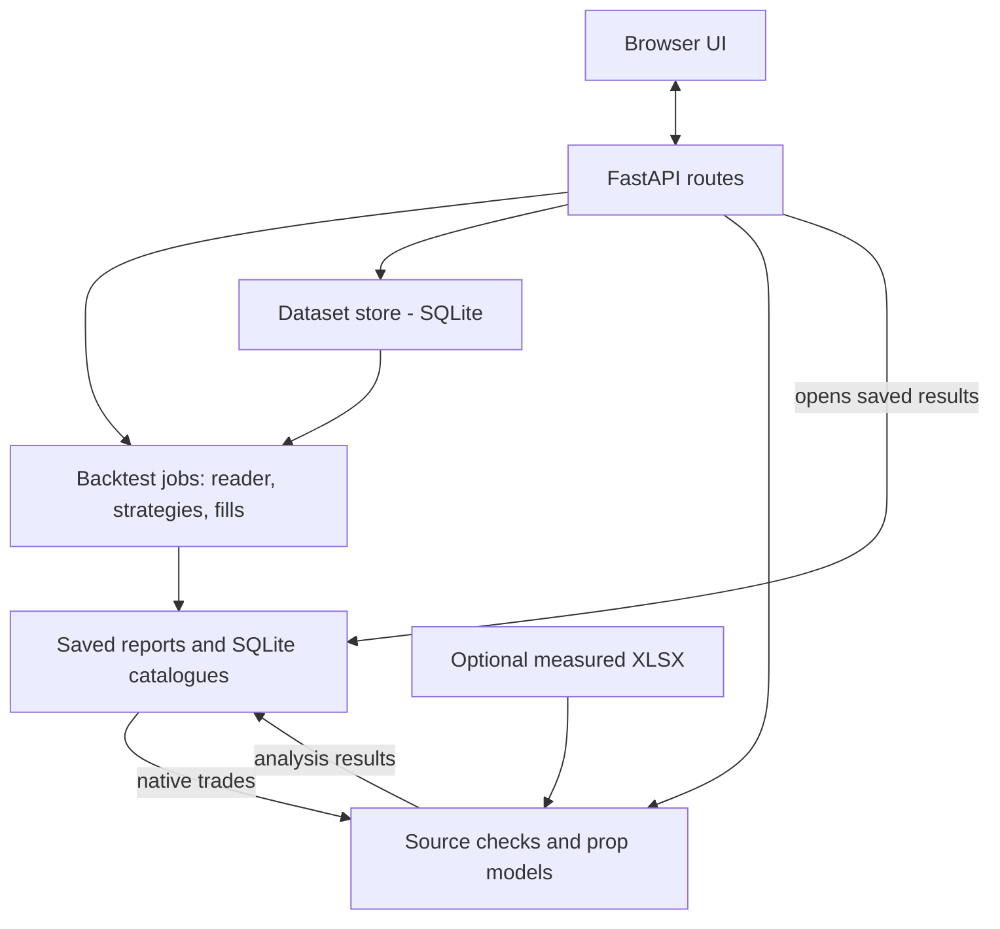

# Architecture

[Home](../README.md) / [Docs](README.md)

[Requirements](#requirements-and-scope) · [Workflow](#end-to-end-workflow) ·
[Code](#code-architecture) · [Decisions](#decisions)

Code reviewed 31 October 2026: [6d290c5](https://github.com/yuxuantan/alphaquest-research-engine-2/tree/6d290c5e429c745a4af600e4da7218c680f9a77a).

## Requirements and scope

AlphaQuest is a local, single-user futures research app. It must:

- Validate CSV data and preserve its bytes, timezone and identity.
- Run strategies and parameter searches through the same execution engine, with explicit fills, costs and instrument settings.
- Separate in-sample (IS) research from manually launched out-of-sample (OOS) tests; save each run's settings.
- Calculate supported Apex/LucidFlex prop outcomes locally; check source trades/costs and disclose missing or bar-based risk data.
- Save reports and downloads so reopening never reruns or changes them. External generated results are comparison references only.

The goal is to maximize expected cash received minus added costs within a set period and
loss/spending limits. Current sizing uses annual slot economics, not a full
cash-by-deadline forecast. The proof of concept lasts six months; set the trading
period separately. Order-book depth (L2), a tested MultiCharts .NET live route,
standalone external-backtest imports and multi-strategy allocation remain proposed.
The long-term depth goal covers historical research and live execution; define
fields, depth, event timing, coverage and replay needs per strategy. Full
MultiCharts feature parity and commercialization are outside the initial scope.
Judge the POC by mechanics, repeatability, prop accuracy, execution reliability,
research throughput, spending and engineering hours.

## End-to-end workflow

Start with the [setup instructions](../README.md#run), then use the existing portal:

1. **Datasets:** validate/save a CSV with its source timezone, tick size and point value.
2. **Strategies → New backtest:** choose strategy, costs and IS/OOS split. Equal parameter bounds run one combination; wider ranges run a grid through the same engine. Initial runs use IS only.
3. **Open the saved report:** inspect trades, metrics and the holding comparison. New runs attempt default Apex/LucidFlex prop analyses; incompatible sources show a reason.
4. **Configure prop analysis → Check source → Run analysis:** inspect native risk data or a matching optional MultiCharts export, set supported account/cost settings, then simulate account passes, failures and payouts. Save/reopen the normal report and downloads. The prop model's internal training/holdout stays within the chosen research period.
5. **Run OOS with these parameters:** manually launch from a completed IS report using its saved window/settings. Splits remain editable and attempts unlimited; record prior data access before treating OOS as untouched final evidence.

Before a final research decision, set limits and freeze the selected package
([research checks](research_workflow.md#campaign-checks)). A later live pilot also
needs real permissions, routing, protection and recovery tests; this workflow
does not place live orders. See [product steps](strategies_navigation.md) and
[prop model details](prop_simulation.md).

## Code architecture

One local server serves the UI and APIs. Arrows show calls/data flow, not separate
services. Jobs use local threads/processes; reports and catalogues share one data root.

| Component | Code | Why separate |
| --- | --- | --- |
| UI and HTTP | [Portal](../alphaquest/web/index.html), [UI code](../alphaquest/web/app.js), [app](../alphaquest/app.py), [backtest API](../alphaquest/backtest_api.py), [prop API](../alphaquest/prop_api.py) | Forms/routes collect settings and coordinate work; calculations stay reusable. |
| Data | [datasets](../alphaquest/datasets.py), [reader](../alphaquest/backtest_data.py) | Validate and snapshot saved bytes; stream bars without changing source data. |
| Strategies and fills | [registry](../alphaquest/strategies/registry.py), [interface](../alphaquest/strategy.py), [execution](../alphaquest/execution.py) | Strategies request orders; the shared engine applies fills/costs. New strategies reuse execution rules. |
| Research and jobs | [splits/OOS](../alphaquest/research.py), [grids](../alphaquest/optimization.py), [workers](../alphaquest/optimization_worker.py) | Trials share the backtest path; workers calculate, the coordinator publishes. |
| Prop calculations | [source checks](../alphaquest/prop/source.py), [analysis](../alphaquest/prop/native_analysis.py), [Apex](../alphaquest/prop/native_engine.py), [Lucid](../alphaquest/prop/lucid_engine.py), [costs](../alphaquest/prop/commissions.py) | Adapt/check trades before account simulation. Firm rules and sizing remain separate from strategy backtests. |
| Default prop reports | [automatic](../alphaquest/prop/automatic.py), [backend](../alphaquest/prop/native_backend.py), [build](../setup.py) | Automatic/manual runs share local models. Optional compiled kernels use the same model source. |
| Reports and storage | [reporting](../alphaquest/reporting.py), [benchmark](../alphaquest/market_benchmark.py), [backtest store](../alphaquest/backtest_runs.py), [analysis store](../alphaquest/prop/store.py) | Stage calculations, publish completed results, reopen without replay. SQLite indexes files and job state. |
| Reuse | [replay cache](../alphaquest/replay_cache.py), [features](../alphaquest/strategy_features.py), [calculation cache](../alphaquest/prop/calculation_cache.py) | Reuse matching data/calculations by identity; never share mutable strategy positions between trials. |

A local server, SQLite and files keep setup small. Separate services or a database
server would add operations; reconsider for remote/multi-user use. See
[storage and import contracts](architecture_reference.md) for formats and limits,
[execution assumptions](backtest_contract.md) for strategy-specific behavior, and
[tests/review records](prop_simulation_review.md) for dated evidence. Code links
show implementation, not a new test pass or proof of MultiCharts trade parity.

## Decisions

These choices are **proposed**; adoption dates are unset.
Test platforms and feeds on the actual setup.

| Area | Choice and reason | Alternatives / why deferred | Reconsider when |
| --- | --- | --- | --- |
| ADR-00 · Design | Established execution software plus Python research; focus custom work on prop economics. | Fully custom: more maintenance and delayed research. Platform-only: lacks the required analysis. | First campaign shows excessive cost, effort or interface problems. |
| ADR-01 · Research | ChatGPT Work for discovery, comparison and hypotheses; verify original sources to save reading time safely. | Manual review is slower. AI can misattribute or wrongly transfer findings between markets; papers do not validate our implementation. | Errors recur, sources are inaccessible or checking costs more time than saved. |
| ADR-02 · Coding | Codex with a written specification; extend Python, add C# for the execution target when justified. | Manual coding takes longer. Two implementations add maintenance and can share the same specification error; compare each with independent cases. | Execution target changes or maintaining parity stops being worthwhile. |
| ADR-03 · Visual checks | Reuse paid MultiCharts .NET charts/imports/trade markers; familiar tools and no extra visual licence while covered. | TradingView for bars, Sierra depth replay/ACSIL or Python traces; switching adds validation work. Charts/DOM alone do not prove historical depth replay or queue-aware fills. | Required features cannot be checked, or another reference meets needs more easily. |
| ADR-04 · Tracking | AlphaQuest for runs, Git for code, run folders for large logs/evidence; optional Sheets links research, campaigns, variants and run IDs. | Manual status updates can drift; a custom tracker adds code and duplicate state. Status without evidence cannot approve deployment. | Review after 10 strategies, or sooner if manual updates cause repeated errors. |
| ADR-05 · History | Start with verified/licensed Sierra history and TIP bridge features; low spending limits which strategies are possible. Specify fields/period first. | Compare bought/recorded data on equal coverage/rights. Trades alone are not synchronized quotes/depth. Rithmic bulk history remains conditional on contract/range limits; live access is not a history purchase. | A strategy needs missing fields, depth or history; no need to exhaust L1 first. |
| ADR-06 · Prop models | AlphaQuest owns simulation, sizing, economics and saved reports; no extra engine licence, but testing/maintenance still cost effort. | Platform reports/notebooks lack the full workflow. External engines remain references only. Closed trades alone may not support intraday equity rules. | Reference cases differ or build spending stops improving decisions. |
| ADR-07 · Live data | Reuse prop-provided Rithmic through MultiCharts for entitled L1/L2; avoid a second feed subscription where the needed data is included. | Databento is the planned paid option for MBO/L3 or independent history/API needs. Platform access is not custom API permission; L2 inclusion depends on the plan. | Missing fields, outages, changed fees/permissions or inadequate quality; verify depth and session limits. |
| ADR-08 · Execution/hosting | Propose MultiCharts .NET; choose Parallels/VPS by uptime, supervision and recovery needs. Count shared platform costs once. | Sierra, NinjaTrader, MotiveWave or Python adapters add integration work; VPS adds cost. Enough CPU/RAM does not prove reliability. PickMyTrade is optional, not automatically another charge. | Routing/recovery fails, licences/connections are unsuitable or another option costs less overall. |
| ADR-09 · Reconciliation | Compare expected signals/orders, submissions, acknowledgements, fills and positions with broker records; quick setup, recurring manual review. | Automated imports/APIs/aggregation need integration/testing. Broker records establish actual fills/exposure; missing protection or unexplained positions differ from ordinary fill variation. | Review exceeds 30 minutes/day or detection is too slow. |
| ADR-10 · Repeatability | Save code, inputs, settings, rules, costs, data conventions and seeds; keep credentials outside versioned evidence. | Ad hoc files lose traceability; a versioning service adds setup. Check deterministic and random outputs using declared tolerances. | Data types, machines or volume outgrow simple manifests. |
| ADR-11 · Risk controls | Define where protective orders live, who controls them, account limits, stale-data actions, emergency intervention and restart. | Untested defaults lack proof; custom order management adds maintenance. Test the actual route and do not resume into unexplained broker state. | Incident, protective-order/routing/account change or platform limits require different controls. |
| ADR-12 · Selection | Set search limits; select on development prop economics, then freeze choices before final OOS. | P&L/win rate/profit factor omit account economics; Monte Carlo cannot replace OOS. | Holdout has been reused, rules/strategy change or evidence is too imprecise. |

Keep IDs and earlier reasons when changing decisions.

The data choice is about **incremental cost and exposed fields**, not a universal
“free L2 / paid L3” split. Lucid offers market depth, but its public pages do not
confirm free L2 for every Rithmic account. Databento is our planned MBO/L3 option;
Rithmic also advertises MBO, so Databento is not the only possible supplier.
See [checked access sources and assumptions](planning.md#market-data-access).

Cost reasons remain above; [dated planning figures](planning.md) are optional.
The [future export format](designs/trade_export_v1.md) is a proposal, not a supported input.
